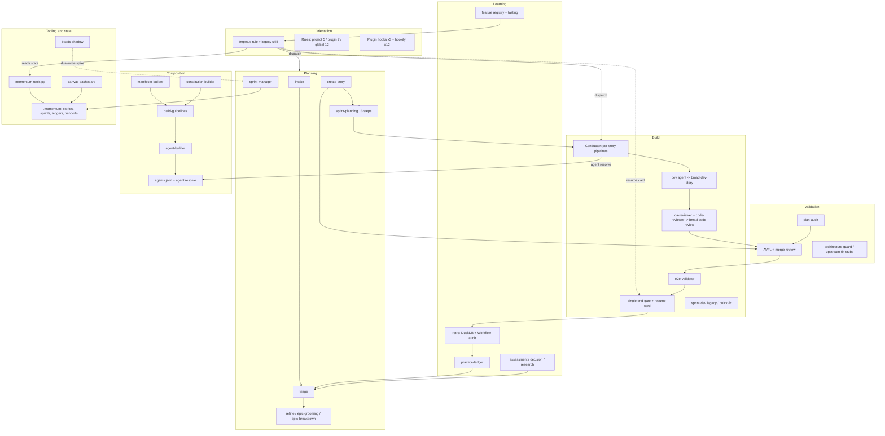

# Momentum Audit, Phase 1: Capability Map

Date: 2026-11-07. Scope: the Momentum plugin (`skills/momentum/`), its project state (`.momentum/`), and supporting directories in `/Users/steve/projects/momentum`. Sources: 16 subsystem readers. This report describes; later phases judge. Counts come from the readers and are marked "approx." or "reader-reported" where unverified. Where readers disagree, the disagreement is noted.

---

## 1. Executive summary

1. Momentum is a solo developer's "agentic engineering practice" delivered as a Claude Code plugin (v0.34.0). It began 2026-03-10, on the Claude 3.x/4.x model line, and has 1,786 commits through 2026-10-25 (docs 676, fix 354, feat 281, chore 275).
2. Core theses: spec-driven development (Specs > Tests > Code), producer/verifier separation, an evaluation flywheel that traces failures upstream, three enforcement tiers (hooks, workflows, advisory rules), and, since DEC-040 (Aug 2026), "honesty": features count only after a human records a verdict.
3. Scale: 30 skill directories (38 SKILL.md counting nested sub-skills; the README and site say 27), 6 agent definitions, 3 plugin hooks, 18-19 command shims, 5 project rules, 7 plugin-bundled rule copies, 12 global rules, 12 hookify rules, and a 4,261-line Python CLI (`momentum-tools.py`, about 45 leaf subcommands) with a 6,558-line test file.
4. The surrounding corpus is large: about 298 markdown eval specs (13.4k lines), 41 decision records (389 KB), 561 stories, 34 sprint directories, and about 530 research/design files (135k lines).
5. The build engine, the Conductor, is a 3,263-line prose workflow with 116 commits. The planning engine, sprint-planning, is a 1,672-line workflow with 71 commits. Together with Impetus they hold most of the surface area and churn.
6. Real use is evidenced: 22 completed sprints, 10 quickfixes, 5 conducted builds with ledgers (578 rows), 13 retro transcript audits, and a 275-event practice ledger.
7. The most recent sprint (sprint-2026-08-03) merged all 8 stories but closed `failed` on 2026-10-28: "shipped but not hands-on verified".
8. Maturity is uneven. Impetus, Conductor, sprint-planning, retro and the CLI are production-used. The composition pipeline has produced one composed agent in one project. Feature registry, tasting, and resume cards were released in the last two weeks of Oct 2026 and have no artifacts in the Momentum repo. Several skills are stubs or deprecated (upstream-fix, feature-status, architecture-guard effectively orphaned).
9. Overlap with native Claude Code is substantial in orchestration (Workflow tool, subagents), review (/code-review), hooks/rules/plugins, dashboards and approval surfaces (Artifacts), and persistence (memory, SessionStart hooks). Little or no native overlap exists for the story/sprint/epic state model, contract-frozen verification, the stakes-class finding schema, and DuckDB-over-transcripts analysis.
10. Almost no eval is mechanically executed: the 298 markdown evals have no runner. The executable tests (CLI tests: 1,230 checks passed on 2026-11-07) are the only automated assurance.

---

## 2. How the subsystems connect

Loop in words: Impetus orients, intake/triage/refine feed the backlog, sprint-planning produces frozen contracts and a plan gate, the Conductor builds with per-story review and AVFL-on-merge, the end-gate asks the human, retro mines transcripts into ledger entries and stubs, which return to triage. DEC-040 added the feature registry as the scoreboard Impetus reports first.

---

## 3. Subsystem sections

Maturity vocabulary: production-used, partial, implemented-untested, superseded, deprecated, stub, unknown. "Evals" below means markdown behavioral specs unless stated.

### 3.1 Orientation

Purpose: always-loaded and session-start layer. Impetus persona (rule plus legacy skill), three tiers of rule files, advisory hooks, command shims, plugin manifest.

| Name | Kind | Purpose | Maturity | Evidence |
|---|---|---|---|---|
| Impetus rule (`.claude/rules/impetus.md`) | rule | Persona; one Bash call gathers state; 1-2 sentence report led by pending resume card, tasting nudge, then N-of-M features, plus ledger counts | production-used (header says "Experimental") | 167 lines, last touched 2026-10-25; backing commands exist; first-turn rendering not verified |
| Impetus skill (sanctum model) | skill | Legacy `/momentum:impetus`: plugin-cache preflight, sanctum files, First Breath | partial | 3,373 lines in dir; sanctum `sessions/` has 0 logs; coexists with rule ("not retired") |
| Impetus evals | eval | 26 specs (reader 1) / 81 eval files (activity reader) | implemented-untested | No runner found; several test the bypassed 9-state menu |
| session-greeting.md, practice-overview.md | doc | 9-state greeting table; "Eight Principles" and `/momentum:dev` start | superseded | Last touched 2026-04-22 / 2026-04-04 |
| Project rules x5 | rule | dev-skills, handoff-conventions, plan-audit, version-on-release, impetus | production-used | 207 lines; version bumped 0.34.0 under release rule |
| Plugin-bundled rule copies x7 | rule | anti-patterns, authority-hierarchy, cmux, decision-grade-presentation, model-routing, verification-standard, workflow-fidelity | partial | 927 lines; 3 of 6 comparable pairs drifted from `~/.claude/rules`; no sync mechanism found |
| Global rules x12 (`~/.claude/rules`) | rule | cmux, decision-grade, verification-roles, authority-hierarchy, mise, git-discipline, model-routing, anti-patterns, spawning-patterns, inline-context, workflow-fidelity, markdown-preview | production-used | All injected into sessions; anti-patterns and model-routing are near-stubs |
| Plugin hooks (hooks.json + 3 scripts) | hook | PostToolUse lint-format, PreToolUse file-protection, Stop stop-gate (advisory, exit 0) | partial | Scripts dated April; `~/.claude/momentum/hooks` empty; nornspun/chorgi have no local copies; only gate-findings.txt is 2026-04-09 |
| Hookify local rules x12 | hook | Block coauthor trailer, destructive git, `momentum install`, push, cmux send w/o Return, legacy version managers, SDR/ASR terms | unknown | Global settings show hookify disabled; coauthor rule conflicts with current harness attribution reminder |
| commands/ shims | cli | One-line "invoke the skill" entries | production-used | 18 files (reader 1) vs 19 (activity reader); 17 are 1 line; none for retro, triage, intake, decision, assessment, refine |
| Plugin manifest | other | name, version 0.34.0 | production-used | 9 lines; relies on directory convention |
| configuration-gap-detection.md and cross-cutting references | doc | Shared contracts (completion-signals, finding-schema, manifesto-format, etc.) | partial | About 4,278 lines in references/; config-gap not invoked by rule-based Impetus |

Complexity observations:
- Impetus has two implementations at once; the rule says the skill is "bypassed" but "not retired".
- The greeting contract has a 2-sentence cap, 4 floor elements, 2 precedence exceptions, 3 tasting tiers, and a resurface-count read-modify-write inside one Bash call. It is enforced by model compliance with prose.
- Hook delivery chain: plugin shim, then project path probe, then global fallback, then silent no-op. Live in one of three projects.
- Documentation drift: practice-overview, session-greeting and feature-status pointers are stale.
- Working tree shows `.claude/rules/workflow-fidelity.md` and three `.claude/skills/momentum-*` entries deleted, uncommitted.

### 3.2 Planning

Purpose: ideas to backlog stubs, backlog/epic structure, story enrichment, state transitions, sprint plan with human sign-off.

| Name | Kind | Purpose | Maturity | Evidence |
|---|---|---|---|---|
| sprint-planning | skill | 13-step plan: synthesis, selection, create-story, frozen contracts with adversarial guard, coherence gate, Gherkin, spec-impact, team composition, AVFL plan check, HTML plan gate, activation | production-used | 4,798 lines total (workflow 1,672; 4 refs 1,326; 25+ evals); 71 commits; 22 completed sprints; fractional steps (3.5, 3.6, 4.5, 5.5) |
| create-story | skill | Create or enrich a story; change-type classification; EDD/TDD notes; AVFL | production-used | 1,204 lines, 9 steps, 9 evals; 22 commits; most-referenced skill (15 plugin files) |
| intake | skill | Fast stub capture, no worktree | production-used | 590 lines, 3 evals; unchanged since 2026-05-28 |
| triage | skill | Dedup gate, five-class batch classification, delegation | production-used | 1,002 lines, 10 steps, 8 evals; DEC-033 migration comments inline |
| refine | skill | Backlog hygiene, drift, stale stories | production-used | 863 lines, 12 steps, 5 evals; deleted 2026-04-07 and re-created |
| epic-grooming | skill | Epic taxonomy, value analysis, epics.json | implemented-untested | 481 lines; several evals only 8-9 lines |
| epic-breakdown | skill | Enumerate missing stories for an epic | implemented-untested | 460 lines; only 2 sprint-file mentions |
| sprint-manager | skill | Documented sole writer of story/sprint indexes | production-used | 459 lines; only 2 other workflows name it; beads dual-write marked SPIKE |
| gherkin-template.md | doc | Gherkin spec template | production-used | 142 lines, 2026-04-08 |
| spec-contextualization.md | doc | Spec context guidance | unknown | 115 lines, 2026-03-23; consumer not checked |
| sprint-tracking-schema.md | doc | Index and frontmatter schema | production-used | 228 lines, 2026-10-25 |

Complexity observations:
- sprint-planning is about 49% of the planning subsystem's roughly 9,860 lines, with about 71 CLI calls embedded in prose.
- Up to four indirection hops from invocation to behavior (command, SKILL.md pointer, workflow.md, Impetus dispatch).
- Contract surface (frozen contracts, coherence gate, contract-format-guide 396 lines) is a Momentum-specific protocol the Conductor must consume.
- State is spread across stories (473 files here, 250 nornspun, 59 chorgi), two indexes, epics.json, intake queue, ledger, handoffs.
- Eval depth varies from 8 to 157 lines per file.

### 3.3 Build

Purpose: turn an approved sprint into merged, reviewed code and a human sign-off.

| Name | Kind | Purpose | Maturity | Evidence |
|---|---|---|---|---|
| Conductor (`/momentum:conduct`) | skill | Pre-flight guards, dependency-frontier per-story pipelines, stage-3 fix loop, AVFL-on-merge, E2E, single end-gate; invariants: sole git mutator, sole spawner, no code writing, no story cap | production-used | workflow.md 3,263 lines, about 216 check/action tags; 116 commits; ledgers for 5 sprints |
| Conductor references x5 | doc | escalation (DEC-036), resume-card, build-ledger, endgate-report-renderer, per-story-review-diff-range | production-used | 1,302 lines |
| Conductor evals | eval | 37 (build reader) / 48 (activity reader) scenario files | implemented-untested | About 2,750 lines; no runner |
| sprint-dev (legacy wave loop) | skill | Older executor with TaskCreate tracking | superseded | 826 lines (1,247 with refs); 44 commits; still edited 2026-08-25; no deprecation marker |
| quick-fix | skill | Five-step single-story path, epic "ad-hoc" | production-used | 500 lines; 10+ quickfix sprints |
| dev skill | skill | Thin wrapper over bmad-dev-story; fix-mode Step 0.5 | production-used | 219-line workflow; not user-invocable |
| code-reviewer | skill | Non-interactive adapter over bmad-code-review; normalizes to finding schema | production-used | 47 + 367 lines; 2 stub-level evals |
| agents/dev.md | agent | Green-field and fix-mode implementer, write-scope enforced | production-used | 256 lines; lists Agent tool despite "no subagent spawning" invariant |
| agents/qa-reviewer.md | agent | Executes the frozen verification contract; silent-downgrade guard | production-used | 219 lines; 16 commits |
| agents/e2e-validator.md | agent | Black-box validation on integrated branch | production-used | 234 lines |
| completion-signals.md | doc | Signal formats | unknown | 295 lines, 2026-04-04, predates Conductor |
| directed-fix-invocation-contract.md | doc | v1.2 fix-mode contract | production-used | 256 lines |
| finding-schema.md + stakes-classification-rubric.md | doc | Normalized finding v1.1; stakes classes | production-used | 226 + 127 lines |
| build-results-ledger-schema.md | doc | Per-story result rows | unknown | 112 lines; apparently overlaps build-ledger design |
| rules/verification-standard.md | rule | Verification keyed to assembled surface (path is `references/rules/`) | production-used | 247 lines, 2026-10-24 |
| Resume card / pending-gate | state | Persist an unresolved gate across sessions | implemented-untested | Implemented 2026-08-25; 0 resume-card.json files exist |

Complexity observations:
- 116 commits on conductor in about 4.5 months; many are repairs to the machinery (merge gate, supersession rows, resume idempotency). The first live run (2026-06-10) was a sprint to fix the Conductor's own seams.
- At least five versioned contracts must agree (finding schema, stakes rubric, directed-fix, build-ledger vocabulary with 22 event types, resume card), plus the frozen two-part verification contract and DEC-035/036/039/040.
- Per-story chain depends on external BMAD skills (bmad-dev-story, bmad-code-review).
- Orchestration is prose interpreted by the main session, not a Workflow script.
- Ledgers: 15 stories launched (07-13, 157 rows), 8 (08-03, 159 rows; 73 dispositions, 15 escalations).
- Inconsistencies: conductor SKILL.md says DEC-039 "pending" while 08-03 added goal conditions; agent model pins are floating aliases (sonnet/medium).

### 3.4 Validation

| Name | Kind | Purpose | Maturity | Evidence |
|---|---|---|---|---|
| avfl | skill | 4 lenses x Enumerator/Adversary, Haiku consolidator, Sonnet fixer, score 95, up to 4 iterations | production-used | SKILL.md 335 + framework.json 893; 14 commits; run in 5 sprints: CLEAN x3, NON_CONVERGENT 71 and 79 (latest two) |
| avfl-merge-review (workflow-merge-review.md) | skill | Post-merge 3-dot-diff AVFL for the Conductor | production-used | 333-line markdown (not a JS Workflow); story to convert it is in backlog |
| AVFL role sub-skills x5 | skill | Pin model/effort per role | production-used | 13-45 lines each; pins name 4.x-era models |
| AVFL benchmark variants (3 tracked + 13 gitignored symlinks) | eval | Single-variable benchmark copies | superseded | About 880-905 line framework.json duplicated 3x; unchanged since March |
| avfl-workspace benchmark (phases 1-6) | eval | Lens count, composition, model, effort, e2e, real PRD | production-used (historical) | 333 files, 22,951 lines; all 2026-03-20; single trial; phase 6 recall 4 of 20 vs human fixes |
| benchmarks/ (Goose recipes) | eval | Non-Claude model comparison for sprint-planning | stub | 14 files; 2 commits; data/results dirs absent |
| plan-audit + ExitPlanMode hook | skill | Spec Impact section before plan exit | production-used | 669 lines; hook script exit 2; test passes 3/3; hook in repo settings only, not plugin hooks.json |
| architecture-guard | skill | Read-only drift check against numbered decisions | partial | 83 lines; unchanged since 2026-04-05; called only by legacy sprint-dev |
| upstream-fix | skill | Intended root-cause tracing | stub | 7-line SKILL.md; evals assert stub behavior |

Complexity observations:
- AVFL spans five layers (SKILL, framework.json, sub-skills, merge-review workflow, variants).
- Conductor couples to about 10 AVFL event types with long rehydration clauses.
- Benchmark base is narrow: one day, one synthetic fixture, single trials (phase 1 notes 33-51 point noise on identical input); the orchestrator collapsed iteration 2 into inline self-validation twice.

### 3.5 Learning

| Name | Kind | Purpose | Maturity | Evidence |
|---|---|---|---|---|
| retro skill | skill | Transcript extraction, story verification, audit Workflow, fused gate, stubs, ledger write, closure | production-used | workflow 774 lines, 13-15 evals; 42 commits; audits for 13 sprints; none for 08-03 |
| retro audit-workflow.js | skill | Native Workflow: discover, adversarial verify, synthesize | production-used | 331 lines; no direct unit test |
| transcript-query.py | cli | DuckDB over session JSONL | production-used | 799 lines; unchanged since 2026-05-01; tests 17 with 2 env errors (pytz missing) |
| friction-scan.sh | cli | Frustration-phrase scan | implemented-untested | Repo-root `scripts/`; zero callers |
| assessment | skill | Guided state evaluation, ASR doc | production-used | 5 assessment docs |
| decision | skill | Adopt/reject/defer, DEC doc | production-used | 42 files in decisions/ |
| research | skill | Parallel subagents, Gemini triangulation, AVFL | production-used | 444-line workflow; ~50 files in docs/research; brittle Gemini/browser dependency |
| practice-ledger (8 subcommands) | cli | Append-only observation log, 15-day TTL | production-used | 275 events: 131 created, 121 closed_stale, 20 consumed |
| feature registry (register/verify/status-hash) | state | Acceptance registry; Impetus N-of-M | partial | No features.json in momentum; nornspun has 15 entries with a different status vocabulary (0 "passing") |
| tasting (status/brief) | cli | Daily walkthrough nudge | implemented-untested | About 400 lines; no `.momentum/tasting/` directory anywhere |
| journal-schema.md | doc | Session thread journal | superseded | 160 lines, 2026-03-24; CLI subcommands remain tested |

Complexity observations: ledger is mostly a log (about 92% of created entries auto-closed unconsumed); retro workflow has 6+ phases, 3 guards and 6 bound variables passed between phases; interfaces between phases are prose-defined; orphans include `retro/err.log`; research depends on external Gemini access.

### 3.6 Composition

| Name | Kind | Purpose | Maturity | Evidence |
|---|---|---|---|---|
| agent-builder | skill | Compose base body + constitution + manifesto; write routing entry | partial | 263 lines; no evals; last touched 2026-05-18 |
| build-guidelines | skill | Six-phase orchestrator, G1 gate | partial | 1,722 lines incl. 9-10 evals and e2e harness; 13 commits |
| constitution-builder | skill | Tier 1 constitution, three write modes | partial | SKILL.md 442 lines; 6 evals + evals.json |
| constitution-builder-workspace | eval | skill-creator scratch | stub | 3,287 lines; benchmark all zeros; shipped in plugin tree |
| manifesto-builder | skill | Diagnostic-table manifesto with human curation | partial | 432 lines; created 2026-07-21 |
| agent-guidelines | skill | Stack discovery, path-scoped rules | implemented-untested | 677 lines, 4 sub-skills, no evals; retired by DEC-026 but present |
| Base agent bodies x6 | agent | analyst, researcher, ux, dev, qa-reviewer, e2e-validator | production-used (3 of 6) | 1,115 lines; analyst/researcher/ux have no clear wiring and no evals |
| agents/evals | eval | 8 specs | implemented-untested | 692 lines |
| agents.json + `agent resolve` | state | Role/glob to agent routing | production-used | Momentum `project[]` empty; nornspun has 1 entry; chorgi none |
| manifesto-format.md | doc | Format contract | production-used | 448 lines |
| model-routing-guide.md | doc | Skill-to-model table | superseded | 17 lines; defunct names; no referrers |
| agent-skill-development-guide.md | doc | Authoring conventions | unknown | 99 lines |
| momentum-agentic-kb | other | Tier 3 wiki (Momentum) | stub | 15 files, seeded 2026-07-13 |
| nornspun-agentic-kb | other | Tier 3 wiki (Nornspun) | production-used | 567 files, 3.3 MB; not a git repo |

Complexity observations: about 6,500 lines of plugin content produce one manifesto (71 lines), one constitution (123) and one composed agent (325) in a single project; four hand-offs and three file contracts precede an agent run; composed files live in `.claude/guidelines/agents/`, not the native `.claude/agents/`; the pipeline was built consumer-first and the producer (manifesto-builder) added later.

### 3.7 Tooling and state

| Name | Kind | Purpose | Maturity | Evidence |
|---|---|---|---|---|
| `momentum-tools sprint` (15 subcommands) | cli | Story/sprint state machine, gated completion | production-used | About 1,060 lines; referenced in 46 skill/doc files |
| `momentum-tools session` (7) | cli | stats, greeting-state, preflight, journal, plugin-cache-check | partial | About 1,040 lines; greeting parts legacy |
| `momentum-tools practice-ledger` (8) | cli | Event log | production-used | About 370 lines |
| `feature`, `feature-status-hash`, `tasting` | cli | DEC-040 registry and nudge | implemented-untested | About 760 lines |
| `agent resolve`, `specialist-classify` | cli | Routing; retired no-op shim | partial | shim self-described retired |
| `triage prefilter`, `quickfix`, `version check` | cli | Dedup prefilter, quickfix tracking | partial | About 230 + 60 + 30 lines |
| bin shim + installer | cli | PATH resolution | production-used | 66 + 75 lines |
| test-momentum-tools.py | eval | Regression suite | production-used | 6,558 lines; 320 test functions; 1,230 checks passed 2026-11-07; custom runner, not pytest |
| migrate-features-to-epics (2 byte-identical copies) | other | One-shot DEC-034 migration | deprecated | 2 x 523 lines + 554-line test; 12 env errors (yaml) |
| update-story-status.sh, verify-sprint-build-consumable.sh | other | Legacy updater; fixture verifier | partial | 166 + 327 lines |
| `.momentum/` layout | state | Stories, sprints, ledgers, handoffs | production-used | 21 MB; 561 story entries (273 backlog, 224 done, 59 dropped); 34 sprint dirs; 53 handoffs |
| beads/Dolt shadow | state | Optional `bd` tracker | partial | 50 issues; 32 of 561 stories mapped; 7.2 MB; gitignored; labeled SPIKE |
| hooks.json | hook | See 3.1 | partial | Same item |

Complexity observations: one 4,261-line monolith with 96 functions; three overlapping "things to do" stores (stories 561, ledger, beads 50); cross-project schema divergence (features.json vocabulary, intake queue); root clutter in `.momentum/` (one-off snapshots, generator scripts); subcommand counts differ by reader (11 top-level; 44 / about 45 / 51 add_parser).

### 3.8 Surfaces

| Name | Kind | Purpose | Maturity | Evidence |
|---|---|---|---|---|
| canvas skill | skill | Launch dashboard in cmux pane | partial | 127-line workflow; cmux steps likely unreliable (inferred, unverified) |
| canvas server.tsx | other | Hono/Bun dashboard on :3456 (cycle, sprint, epics) | implemented-untested | 2,229 lines; 86 bun tests pass; polls 2-5s; no features lens |
| canvas server.test.ts | eval | Unit/HTTP tests | production-used | 1,214 lines; 2 HTTP-level tests |
| canvas evals | eval | 2 specs | unknown | 26 lines |
| feature-status skill | skill | Deprecation stub | deprecated | 9-line workflow; 6 evals (547 lines) describe removed behavior |
| findings-server MCP | other | Planned ledger query layer | stub | 9-line README |
| site/index.html + pages.yml | doc | Public explainer | implemented-untested | 1,023 lines; says 27 skills |
| module/canonical | other | Practice templates | unknown | 379 lines; zero inbound references |
| momentum/agents.json + verification-harness.json | other | Routing and driver config | production-used | 11 + 117 lines |
| `_bmad/` config | other | Vendored BMAD config, impetus sanctum | partial | 167 files |
| friction-scan.sh, practice-ledger-hygiene script | cli | Scan; one-shot cleanup | implemented-untested / retired | No callers; DO NOT re-run |
| package.json, version.md | other | Root versions | stub / superseded | Both 1.0.0 vs plugin 0.34.0 |
| skills-lock.json | state | External lock file | unknown | Gitignored; 90 of 91 names match no skill dir |
| AGENTS.md | doc | Beads instructions | production-used | 48 lines |

Complexity observations: three version sources disagree; no surface renders the feature registry; HTMX polling reads up to about 520 KB of JSON per tick.

### 3.9 Evals

| Name | Kind | Purpose | Maturity | Evidence |
|---|---|---|---|---|
| Markdown behavioral evals | doc | Given/When/Then specs for LLM-executed skills | partial | 298 files, 13,377 lines, 656 KB; no runner; stale refs (`skills/momentum/evals/` does not exist) |
| constitution-builder evals.json | eval | 27 grep assertions | implemented-untested | No harness |
| Trigger eval loop | eval | Description trigger accuracy | production-used (once) | Ran once; hard-coded machine path |
| test-momentum-tools.py | cli | See 3.7 | production-used | 1,230 checks pass |
| test-migrate-features-to-epics.py | cli | Migration tests | deprecated | 12 yaml errors |
| test-transcript-query.py | cli | DuckDB tests | partial | 2 pytz errors |
| plan-audit hook test | doc | Bash test | production-used | 3 of 3 |
| Agent evals | eval | 8 specs for 3 agents | partial | analyst, researcher, ux: none |
| `*.eval.yaml` verification contracts | state | 65 per-story contracts in sprint specs | production-used | The only eval artifacts that flow through state |

Observations: eval-to-non-eval line ratio about 0.63; impetus has 3.6x eval lines vs SKILL.md; pytest not installed; hyphenated test filenames fall outside pytest defaults; a micro-eval runner story sits in backlog; 4 eval-derived ledger items closed stale without resolution.

### 3.10 Activity (see section 7 for metrics)

The activity reader catalogued the same 30 skills with first/last commit, counts, and references. Selected per-skill commit counts: conductor 116, sprint-planning 71, sprint-dev 44, retro 42, impetus 40, canvas 36, dev 27, create-story 22, triage 17, quick-fix 15, avfl 14, build-guidelines 13, epic-grooming 12, constitution-builder 12, intake 11, code-reviewer 11, refine 11, plan-audit 9, sprint-manager 8, research 7, decision 6, agent-builder 6, architecture-guard 5, assessment 4, epic-breakdown 3, manifesto-builder 3, upstream-fix 3.

### 3.11 Evidence stores (`.momentum/`)

| Name | Kind | Purpose | Maturity | Evidence |
|---|---|---|---|---|
| Sprint registry (`sprints/index.json`) | state | 22 completed, 10 quickfixes, none active | production-used | One entry has slug None; early three lack status |
| Build ledgers | state | Per-sprint event stream | production-used | Only 5 sprints; 578 rows; 43 story-terminal (41 merged); 08-03 untracked in git |
| Conduct-core and conduct-runnable snapshots | state | June 2026 exports | production-used | Incompatible schemas (three build-result schemas) |
| Sprint narrative artifacts | doc | Summaries, retro audits | partial | 13 audits (480 KB), 9 summaries; none for 05-26, 06-05, 06-10, 08-03 |
| Planning artifacts | doc | Specs, coverage plans, coherence reports | production-used | coherence-report only for 08-03 |
| Resume cards | state | Pending gate | implemented-untested | 0 files |
| Story store | state | 472 md + index | production-used | 62,251 lines; 561 index entries vs 472 files |
| Report generators (gen-*.py) | cli | June one-off renderers | superseded | Inputs gone; hard-coded slugs |
| Sprint closure semantics | rule | done vs failed | partial | One closure record; `goal_conditions` empty |

### 3.12 Vendored BMAD suite (`.claude/skills`, `_bmad/`)

| Name | Kind | Purpose | Maturity | Evidence |
|---|---|---|---|---|
| bmad-dev-story | skill | Story implementation | production-used | Hard dependency via dev agent |
| bmad-code-review (+2 sub-reviewers) | skill | Three-layer review | production-used | Adapter must bypass its steps |
| bmad-create-story | skill | Story file builder | production-used | Wrapped by create-story |
| bmad-testarch-* x8 + bmad-tea | skill | TEA test architecture | implemented-untested | About 230k lines; 53 unique of 401 knowledge files; zero plugin references |
| bmad-teach-me-testing | skill | Testing course | implemented-untested | 6,634 lines |
| bmad-quick-dev | skill | Intent to code | implemented-untested | Overlaps quick-fix |
| Planning-phase skills (~14) | skill | PRD, UX, architecture, epics | partial | Used early; deprecation stubs for create/edit/validate-prd |
| Research skills x3 | skill | Structured research | implemented-untested | One plugin reference |
| Sprint/retro skills x4 | skill | BMAD sprint flow | superseded | By Momentum's own |
| Agent personas and CIS | agent | Personas and coaches | implemented-untested | No plugin references |
| Party mode, elicitation, brainstorming, etc. | skill | Utilities | implemented-untested | About 3.4k lines |
| BMB builders x6 | skill | Builders and eval runner | partial | About 16.6k lines; zero use of eval-runner |
| avfl-2lens/3lens/declining | skill | Variants | deprecated | Dated 2026-03-22 |
| frontend-dev-workspace | eval | cmp-dev eval workspace | stub | Benchmark placeholders |
| `_bmad/` config | state | Installer state | production-used | 1.2 MB; gitignored; BMAD 6.8.0; copied per project (chorgi 71, nornspun 69 skills) |

Observations: 73 skill directories, about 12 MB; only 3 vendored skills are hard dependencies; about 60 of 68 have zero plugin references; none is dated in git because all is gitignored.

### 3.13 Legacy local install (`.claude/momentum`)

| Name | Kind | Maturity | Evidence |
|---|---|---|---|
| journal.jsonl + journal-view.md | state | deprecated | 323 B, includes deliberately corrupt lines |
| installed.json | state | deprecated | Last invocation 2026-04-23; still referenced by CLI and evals |
| protected-paths.json + file-protection.sh | hook | production-used | Wired in `.claude/settings.json`; two copies diverge from plugin copies |
| lint-format.sh | hook | stub | Settings entry is an echo placeholder |
| stop-gate.sh + gate-findings.txt | hook | stub | Unwired; findings stale snapshot |
| `.claude/hooks/check-version-bump.sh` | hook | production-used | Push-time bump gate, wired |
| feature-status.html/.md/mockup | dashboard | superseded | 40.7 KB frozen snapshot of 21 features |
| greeting-mockup.md | doc | superseded | Shows numbered menus the rule now forbids |
| test-bad.json | other | deprecated | 19 B |

### 3.14 Project docs corpus

| Name | Maturity | Evidence |
|---|---|---|
| docs/research (197 files, 43.6k lines) | production-used | Cited by 8 decisions; raw+validation to final about 14:1 |
| `_bmad-output/research` (227 files, 53.0k lines) | partial | Cited by 6 decisions; last touched 2026-05-18 |
| Nornspun delivery discovery (2026-08-02) | production-used | Source of DEC-040; reports 91 stories done, 0 of 15 features, 0 of 29 process stories shipped; synthesis notes 5 falsified corpus claims |
| Assessments AES-001..004 | production-used | 717 lines |
| sprint-dev-redesign-spec.md | production-used | 998 lines; basis for Conductor |
| End-gate format spec; avfl-triage-dedup | production-used | 154 + 348 lines |
| gas-city-system-design.md | stub | 22 lines of front matter |
| Early implementation artifacts | deprecated | 43 files, about 10.4k lines |
| Impetus quality-analysis (2026-04-19) | implemented-untested | One run |
| Intake retros | partial | 5 files; early dogfood evidence |
| Skill benchmark (2026-05-07) | production-used | n=1 per cell, scored by AVFL |
| Skill/agent landscape HTML | implemented-untested | Says 28 skills; stale |
| Design bundle | partial | 35 files, 17.2k lines |
| Validation artifacts, diagrams, process docs | deprecated | acceptance-testing-standard retired by DEC-029 D7 |
| Beads spike evaluation | partial | Gate 1 left open |

Observations: no skill loads this corpus at runtime; research lives in two trees; the memory notes a skill hardcodes the wrong output path.

### 3.15 Conduct fixtures, generators, CI

| Name | Kind | Maturity | Evidence |
|---|---|---|---|
| sprint-fixture-conduct-e2e | eval | partial | 5 files, 20 KB; shape check passes 2/2; no conductor run against it |
| verify-sprint-build-consumable.sh | cli | implemented-untested | 327 lines; record shape only |
| gen-endgate-report.py, gen-conduct-runnable-report.py | dashboard | stub | Read missing `/private/tmp` files; cannot re-run |
| `.momentum/signals/` README | state | stub | 0 signals ever; superseded by ledger |
| pages.yml | other | unknown | Only workflow; no tests |
| `.worktrees/` | state | production-used | Gitignored, empty now |
| `.beads/` | state | partial | 50 issues; gitignored; newest activity 2026-08-25 |

---

## 4. Intended design and its evolution

Core theses (from the founding plan 2026-03-07, philosophy.md, PRD):
- Spec-driven development under BMAD; authority hierarchy Specs > Tests > Code.
- Producer/verifier separation; evaluation flywheel (trace failures upstream); three enforcement tiers; cost, provenance and attention as managed resources; impermanence.
- Premise cited: external statistics on AI-code quality (PRD: 67.3% PR rejection, 1.7x issues per PR), measured on earlier models.
- Primary persona: solo developer (PRD). The UX spec targets a different persona (new-to-AI team member) and was last touched 2026-04-04.

Timeline highlights:

| Date | Event |
|---|---|
| 2026-03-07/10 | Founding plan; project start; March benchmark campaign for AVFL (one day, 2026-03-20) |
| 2026-03-22 | Bulk removal of about 80 vendored bmad-*/avfl-* dirs from tracked `.claude/skills` (now gitignored); install manifest written |
| 2026-04 (561 commits) | Redesign: epic/sprint/story model, slug IDs, JSON indexes, sprint-manager (Epic 0); Impetus as sole orchestrator; features introduced (DEC-002/004/005) |
| 2026-04-09 to 05-03 | Agent composition re-cut repeatedly (DEC-001, 008, 013, 016, 020, 026, 038); canvas stack changed Vite to Hono/HTMX/Bun within 8 days (DEC-011 to DEC-019) |
| 2026-05-16/17 | Agent taxonomy and routing (DEC-020-027); beads adopted as spike (DEC-028); method-routed validation (DEC-029); DAG dispatch and frozen sprints (DEC-030) |
| 2026-05-22 | Gas City adopted (DEC-032), superseded in 8 days |
| 2026-05-25/28 | Ledger event-log redesign (DEC-033); features collapsed into epics (DEC-034); feature-grooming became epic-grooming |
| 2026-05-30 to 06-04 | Conduct engine adopted on in-session dynamic Workflows (DEC-035/036/037); first live run 2026-06-09/10 |
| 2026-06-16 | Manifesto diagnostic table (DEC-038) |
| 2026-07-10 | Sprint goal and mutable scope amend frozen scope (DEC-039, 54 days after DEC-030) |
| 2026-07-21 | Bulk skill touch: model pins to floating aliases; dev specialist bodies removed (3 dev-* agents); refine/triage rewrites |
| 2026-08-02 | Nornspun discovery; DEC-040 delivery-loop closure (features.json returns as acceptance registry; human-verdict gating; tasting; resume cards) |
| 2026-08-25 | Gas City deferral reaffirmed (DEC-041); resume-card and tasting implemented |
| 2026-10-24/25 | DEC-040 shipped as v0.33.0/0.34.0 (83 days after decision) |
| 2026-10-28 | sprint-2026-08-03 closed `failed` |

Pivots already made: BMAD pipeline to Momentum-native sprint model; wave loop to DAG/Conductor; features to epics and back to a thin feature registry; Vite canvas to Hono canvas; Gas City and beads from adopt to defer/spike; fixture micro-eval (DEC-010) decided but never built; process documents dissolved in favor of enforced rules (DEC-029 D7).

Decision register: 41 DEC records (38 decided, 1 superseded outright, 8 annotated as amended); a second numbering scheme (inline "Decision N", 1-56) lives in architecture.md. Intent documents are large (PRD 1,037 lines with 148 FRs and 23 NFRs; architecture 3,279; UX 1,299; plan 853; master plan 669) and some describe superseded designs.

---

## 5. Native-overlap matrix

Overlap: full / substantial / partial / none (as judged by readers; this phase does not verify native feature behavior).

| Momentum capability | Native Claude Code feature | Overlap | Notes |
|---|---|---|---|
| Conductor orchestration spine (frontier scheduling, fan-out, resume) | Workflow tool, background agents | substantial | DEC-035 chose Workflows as substrate; build loop itself is still prose |
| Per-story spawn model, `agent resolve` | Subagents with model/effort overrides, `.claude/agents`, worktree isolation | substantial | Spawn model is native; routing by touched-file globs has no native equivalent (partial) |
| sprint-dev legacy wave loop | Workflow, tasks | full | Superseded in-house |
| AVFL review/fix loop | /code-review (levels, --fix), /simplify, Workflow | substantial | Document/corpus validation against source material not covered natively (partial) |
| AVFL role sub-skills | Per-call model/effort overrides | full | Pins are 4.x-era |
| code-reviewer adapter, finding schema, stakes rubric | /code-review, /security-review | partial | Schema normalization and stakes-class are Momentum-specific |
| qa-reviewer execute-the-contract verification | none direct | none | Frozen SHA contracts, Part A/B split |
| Plan gate, end-gate HTML reports, canvas | Artifacts (shared db, Dashboard type), plan mode | substantial / partial | Anti-rubber-stamp conventions remain Momentum's |
| Resume card, pending-gate resurfacing | SessionStart hooks, memory, PushNotification, Monitor | partial | Cross-session pending decision has no direct native feature |
| Impetus session-start report | SessionStart hook, CLAUDE.md/rules, memory | substantial | Hook would run state-gathering deterministically |
| Impetus sanctum, journal | Memory, session resume | substantial / full | Sanctum sessions empty; journal superseded |
| Rules (bundled, global) | `.claude/rules`, `~/.claude/rules`, plugins | substantial | Delivery drift unresolved (3 of 6 pairs differ) |
| authority-hierarchy rule | Native memory/rule cascade | full (restates) | 6 lines |
| Plugin hooks (lint, file-protection, stop-gate) | Plugin hooks with plugin-root paths, permissions deny, auto mode | substantial | Shim and migration docs unnecessary |
| commands/ shims | Skills as slash commands | full | |
| Plugin cache preflight | `plugin update` | partial | Mostly matters for a plugin dogfooding itself |
| plan-audit | Plan mode, hooks, rules | partial | Spec Impact content is custom |
| Hookify rules | settings hooks, permissions | substantial | Hookify disabled globally |
| sprint-planning orchestration | Workflow tool | substantial | Prose control flow vs scripts |
| sprint-manager, stories/sprints state | Tasks, schema-validated Workflows | partial / none | Persistent 561-story backlog has no native equivalent |
| intake/triage/refine | Memory, routines, /loop | partial | Dedup, five-class routing, ledger semantics custom |
| create-story AVFL | /code-review, /simplify | partial | Spec validation not covered |
| practice-ledger | Memory, routines, Artifacts db | partial | 92% auto-closed |
| retro audit Workflow | Workflow tool | substantial | Already native |
| transcript-query.py / friction-scan | none | none | Depends on undocumented transcript format |
| decision/assessment docs | Memory, plan mode, Artifacts | partial | Markdown-in-git record not replaced |
| research skill | Subagents, web tools, Workflow | substantial | Gemini cross-check unique but brittle |
| Feature registry, tasting | Artifacts, routines, Chrome / computer use | partial | Human-verdict single-writer contract is bespoke |
| Composed agents, constitution, manifestos | `.claude/agents`, rules, skills progressive disclosure | substantial | Composed files at non-native path |
| agents.json | Subagent descriptions, path-scoped rules | partial | |
| Base agent bodies | Plugin agents, Workflow agent specs | substantial | |
| Markdown evals, benchmarks | `claude plugin eval`, skill-creator | partial | Format conformance unchecked |
| model-routing-guide | Frontmatter + per-call overrides | full | |
| Beads shadow | Tasks, Artifacts db | partial | Spike, 32 of 561 mapped |
| findings-server MCP | MCP | partial | Stub |
| module/canonical, version.md, package.json, skills-lock.json | Plugins and marketplace | full | Stale duplicates |
| `.worktrees/` | Native worktree isolation | substantial | |
| Gas City / unattended dispatch research | Scheduled routines, /loop, background agents, PushNotification | substantial | Post-dates decisions |
| bmad-code-review | /code-review | substantial | BMAD is spec-aware (Acceptance Auditor) |
| BMAD builders | skill-creator, plugins, plugin eval | substantial | |
| BMAD TEA | none (methodology) | partial | Content largely model-known |
| BMAD planning chain (PRD to epics) | Plan mode, Artifacts, Docs | partial | |
| site/ explainer | none | none | |

---

## 6. Maturity rollup

Counts are of rows in section 3 tables (a capability family such as "Base agent bodies x6" counts once), by the maturity each reader assigned. Different readers used the labels slightly differently.

| Maturity | Approx. count of listed capabilities |
|---|---|
| production-used | about 78 |
| partial | about 36 |
| implemented-untested | about 30 |
| superseded | about 14 |
| deprecated | about 11 |
| stub | about 14 |
| unknown | about 8 |

Deprecated / superseded / stub items:
- Deprecated: feature-status skill and its 6 evals; avfl-2lens/3lens/declining; migrate-features-to-epics (two copies); legacy journal.jsonl, installed.json, test-bad.json; test-migrate-features-to-epics.py; REDESIGN-HANDOFF.md and PHASE-3-HANDOFF.md at repo root; early implementation artifacts; acceptance-testing-standard.md; bmad-create/edit/validate-prd stubs.
- Superseded: sprint-dev (no marker in file), session-greeting.md, practice-overview.md, model-routing-guide.md, journal-schema.md, build-ledger-era generator scripts, gen-*.py, greeting-mockup, feature-status.html snapshot, BMAD sprint/retro skills, version.md, DEC-003/004/007/011/032 designs, AVFL role/effort variants.
- Stubs: upstream-fix, findings-server MCP, benchmarks/, constitution-builder-workspace, frontend-dev-workspace, gas-city-system-design.md, signals/ README, lint-format.sh and stop-gate.sh (unwired), package.json, momentum-agentic-kb, gen-endgate scripts. DEC-010's micro-eval and fixture-investigate skills were never created.

Skills with zero evals: agent-builder, agent-guidelines (constitution-builder-workspace is not a skill). Agents with zero evals: analyst, researcher, ux. Skills at exactly 2 evals: architecture-guard, assessment, canvas, code-reviewer, decision, plan-audit, upstream-fix.

Note for later phases: "zero evals" is about spec files. No eval has a runner, so every skill is effectively un-run by eval; the executable assurance is the CLI test suite, canvas tests (86 pass), and the plan-audit hook test.

---

## 7. Activity and churn

Git metrics (whole repo, through 2026-10-25):
- 1,786 commits. By type: docs 676 (38%), fix 354 (20%), feat 281 (16%), chore 275 (15%), unclassified 147 (8%), refactor 38, test 8, revert 6, perf 1.
- By month (approx.): Mar 193, Apr 561, May 329, Jun 286, Jul 107, Aug 66, Sep 0 recorded, Oct 21.
- Plugin version: 0.1.0 to 0.34.0; 63 commits add a version line; minors cluster June to July (0.25.0 to 0.33.0). Releases noted: 0.28.0 (2026-06-08, "conduct engine runnable"), 0.30.0 (06-23), 0.32.0 (07-30), 0.33.0 (10-24), 0.34.0 (10-25).
- Plugin surface: 30 skill dirs, 402 md files, 33,803 lines; agents 1,115 lines; CLI 4,261 lines with 6,558-line test file; scripts dir 13,776 lines in 13 files.
- Churn leaders: conductor 116 commits, sprint-planning 71, sprint-dev 44, retro 42, impetus 40, canvas 36.
- Dormant since April/May: architecture-guard (2026-04-05), hooks (2026-04-09), intake (2026-05-28), agent-builder (2026-05-18), all benchmark and `.claude/momentum` files.

Deleted / rewritten:
- About 80 bmad-*/avfl-* directories removed from tracked `.claude/skills` on 2026-03-22 (bulk), momentum-vfl (03-23), distill (05-21), cycle-dashboard (05-03), feature-grooming/breakdown (05-28), subagent-start/stop hooks (04-08), three dev-* agents (07-21), sprint-planning evals reverted (05-18, commit e3349f17).
- Some deleted names were re-created later (impetus, refine, sprint-planning, triage), so deletion did not always mean retirement.
- Rewrites by dedicated quickfix: refine, triage dedup, feature-breakdown to epic-breakdown; spec-contextualization and model-routing-guide never updated.
- Uncommitted at audit start: deletions of `workflow-fidelity.md` rule and three `.claude/skills/momentum-*` links; modified `CLAUDE.md` and ledger; untracked 08-03 build ledger and two HTML handoffs.

Sprint and delivery footprint:
- `.momentum/sprints`: 34 entries; index 22 completed (21 done, 1 failed), 10 quickfixes, none active. Stories index 561: backlog 273, done 224, dropped 59, ready-for-dev 4, in-progress 1.
- Structured per-finding data exists for 5 conducted sprints only (06-10 onward). Finding yield: conduct-core 96 over 21 stories (87 fixed); conduct-runnable 75 over 25 (about 60 fixed; 12 of 25 QA results PARTIAL, 2 FAIL before fixes); 08-03 73 dispositions (53 fixed, 5 triaged out, 15 escalated).
- sprint-2026-08-03: started 2026-08-21, built in about 18 hours, then sat open until the end-gate fix budget was exhausted 2026-10-24 and closure as failed 2026-10-28 (about 68 days).
- Practice ledger: 275 events in momentum (131 created, 121 closed_stale, 20 consumed, 61 from retro), 168 in nornspun, 2 in chorgi.
- Nornspun comparison points reported by the discovery corpus: 91 stories done, 0 of 15 features working; monthly commit counts declined from 597 to 7 (not re-verified).

---

## 8. Open questions for later phases

Usage and value:
1. Do session transcripts (DuckDB) show Impetus rendering the 2-sentence report, and how often? Which skills, hooks and CLI subcommands are actually invoked by the current Conductor vs legacy paths?
2. Which hooks ever fired in any project (only momentum carries scripts; nornspun/chorgi have none)? Did file-protection ever block a write?
3. Retro conversion: of 61 retro-sourced ledger entries, how many became shipped stories vs stale closes? Did retro-found issues reduce later defects?
4. Why are `retro_run_at` null for 05-26, 06-05, 06-10 and 08-03? Does transcript-query.py still parse current transcript format (unchanged since 2026-05-01; last confirmed audit is 07-13)?
5. What happened in sprint-2026-08-03 between 2026-08-25 and 2026-10-24? Was `goal_conditions` empty by design?
6. Are fixes in the conducted sprints mostly doc/spec consistency vs product bugs? A per-finding classification is needed.

Cross-project evidence:
7. What do Nornspun and Chorgi `.momentum` stores, features.json (different status vocabulary), composed agent (dev-kotlin-compose), and tasting state show? Was the composed agent ever spawned, and did it outperform plain dev.md? (The 2026-05-07 benchmark found no-skill beat compose-expert on a well-specified story; n=1.)
8. Were vendored BMAD skills used beyond dev-story, code-review and create-story in the other projects?

Mechanics and drift:
9. Does any mechanism sync plugin rule copies into `~/.claude/rules`? Which copy is authoritative for file-protection and protected-paths?
10. How is sprint-manager's "sole writer" enforced? Do `.claude/momentum/installed.json` and journal still have runtime readers?
11. Does the plugin's `agents/` register as native agents, or only via the resolver? Is the eval markdown format compatible with `claude plugin eval`?
12. Do AVFL's sub-skill model pins (4.x-era) and benchmark conclusions hold on 5.x models? Was the proposed mitigation for iteration-2 inline-collapse added?
13. Do canvas launch steps work live under cmux? Is the registry meant to have a surface?
14. Does the test suite for transcript-query and migration pass in a correctly provisioned environment (pytz, yaml)?

Data caveats to carry forward: substring-grep "mention" counts are upper bounds; readers disagree on some totals (commands 18 vs 19; Impetus evals 26 vs 81; conductor evals 37 vs 48; skill count 27/29/30/38 depending on counting rule); the Nornspun discovery corpus lists claims that its own council falsified; the AVFL benchmark and skill benchmark are single-trial and scored by AVFL itself.
